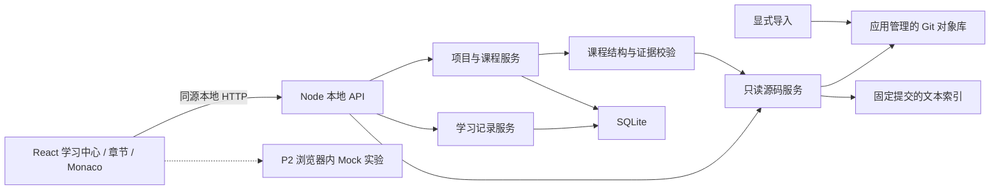

# 整体架构

交付形态为单用户本地 Web 应用。React + TypeScript 客户端负责学习体验；一个绑定回环地址的 Node.js + TypeScript 进程拥有数据目录、Git 适配器、课程验证和 SQLite 写权限。P1 用同源 HTTP、普通请求和单机事务即可覆盖完整学习路径。

| 模块 | 职责和依赖 |
| --- | --- |
| 客户端 | 学习中心、课程与阅读器共享 release 和证据 ID；Monaco 只显示服务端返回的文本，Mermaid 展示经过审核、按严格模式渲染的流程图。P1 可按课程 execution 生成顺序图 |
| 项目与仓库 | 从配置提供来源目录，区分登记和导入；GitHub 获取、本地导入均写入应用管理的对象库。按仓库和 SHA 保留引用；上游地址不构成课程信任证明 |
| 源码读取与索引 | Git tree 枚举，按 blob 读固定文本。P2 按本版 repository/commit 定位受管对象库，批量读取普通 TS/JS/Rust/Python blob 并核对 OID，通过 stdin 交给禁用配置的 ripgrep。每次请求重建内存检索文本，不检出、不写磁盘快照；预算 4000 文件、单文件 1 MiB、合计 32 MiB；展示最多 100 项，扫描到 501 个匹配行提示截断。声明模式与引用都是文本候选，可能包含注释和同名符号，不提供语言级绑定 |
| 课程与验证 | JSON Schema 结构检查 → 引用与前置图 → Git 对象及摘要 → SQLite 发布事务；返回章节及证据索引。客户端不能自行拼接磁盘路径 |
| 学习记录 | 管理状态、疑问、笔记、作答和复习查询；从课程读取答案；写操作绑定版次。单选由后端判定，追踪题记录自评来源（可由题型确定） |
| P2 导师与实验 | 本地导师从审核过的课程断言和证据回答；固定脚本 Mock LLM / Tool 产生事件、状态前后值，步进和自动播放消费同一个事件序列。模拟层只接触教学数据 |

## 三条关键数据流

1. **导入**。用户选项目和来源，后端验证来源及完整提交，获取所需 Git 对象到暂存区，核实 repo 身份及可读性，建立应用自己的持久 Git 引用，再登记 revision。引用先于数据库可见，失败留下的无主暂存可在重启后清理。重复导入复用同仓库同 SHA，不改用户工作树。
2. **学习与双向定位**。章节请求给出 release、证据 ID → 服务端取其仓库、提交、路径及行范围 → 按提交树读取并核对 blob → 返回同一坐标系的文本和标记。阅读器反向查同版同路径与选区相交的证据，经 lesson_evidence 返回章节及阅读位置。
3. **作答与恢复**。前端携带版次、章节、题号和请求 ID → 记录服务核对版本及题型、判定、追加 attempt → 返回解析及证据链接。重开章节以本地记录重建界面。阅读失败、发布失败和学习记录写入失败分别反馈，可独立重试。

## P1 接口契约草案

路径均在本地同源 `/api` 下。外部深链使用项目/课程/版次可移植键解析为本机 release ID。

| 请求 | 输入 → 输出 |
| --- | --- |
| GET /projects | 配置与本地课程 → 项目列表、开放状态、最新已发布版次和进度 |
| POST /imports | 仓库 ID、来源类型、规范 URL 或经本机选择的目录、完整提交 → 导入作业 ID；GET /imports/:id 返回进度或可重试原因 |
| POST /releases | 已登记来源的课程包 → 经校验的不可变版次；同内容重放返回既有 ID |
| GET /releases/:id/lessons/:lesson | 已发布版次 → 十二项课程内容、题目、证据入口、进度；作答解析在提交后展示 |
| GET /releases/:id/tree、/releases/:id/file | 受限的仓库相对路径 → 目录项或文本、blob ID；分页目录，大文件返回元数据 |
| GET /releases/:id/evidence/:key、/releases/:id/backlinks | 证据 ID 或路径和行范围 → 可复核定位或相关章节 |
| PUT /releases/:id/lessons/:lesson/progress | 明确的目标状态 → 已保存状态 |
| POST /entries、PATCH /entries/:id | 所属版次/章节、可选证据、正文或疑问状态 → 已保存条目 |
| POST /attempts、GET /review | 作答及请求 ID → 判定和解析；项目/版次筛选 → 学习记录与待复习错题 |

参数格式错误返回 400，未知资源 404，版次或重复请求冲突 409，内容或证据校验失败 422。错误带稳定原因码、涉及字段及可执行的恢复动作。目录选择只允许用户明确提供的本机来源，导入后的读取接口只接受逻辑 ID 和仓库内路径。

## P2 已实现接口与浏览器实验

| 请求 | 输入 → 输出 |
| --- | --- |
| POST /bundled-releases | 可选 projectId（兼容旧客户端，默认 pi）及已导入的固定对象 → 只按序验证发布所选项目教材，返回最新 release ID 和 projectId；不要求导入其他项目 |
| GET /releases/:id/symbols | symbol、kind=definition/reference、可选 scope → 当前提交内文本候选、路径/行/列、依据、范围与截断标志。标识符限 80 字符，不接受正则；scope 只接受固定 tree 内的相对路径 |
| GET /releases/:id/tutor | 可选 lesson、q（最多 160 字符） → 已审稿职责、调用链、执行流、场景和 FAQ；回答前复验其证据。未命中不生成答案 |
| GET /review | 原筛选参数 → 条目、作答历史、统计和逐题首次/最近结果；不新增持久化 |

Mock 引擎位于 [shared/lab.ts](../shared/lab.ts)，预生成纯教学事件序列。LabPlayer 以游标消费，手动与计时器使用同一序列；暂停、重置、卸载取消计时器并使旧回调代次失效。状态快照深拷贝，外部不能修改内部轨迹。输入与场景变化需明确应用并重置；离开实验即丢弃内存运行。

## 本地部署与扩展

前端静态资源、编辑器及图表依赖随应用本地分发。数据目录包含 SQLite 库、按 repository ID 隔离的 Git 对象库、按 SHA 命名的只读索引缓存，以及按内容哈希存放的官方资料快照。备份覆盖数据库、被引用的 Git 对象和资料快照；文本索引可重建。P1 验收从空目录启动、重启和断网三种情况。

后续项目复用仓库、证据及学习记录接口，各自编写课程。各项目保持独立的 release 和证据。网络模型、桌面打包、远程数据库、多用户同步与真实代码运行需要另行确定使用场景。

P3 已接入 Codex，`bundledCourses` 统一登记 Pi 两版与 Codex 一版；`GET /projects` 的 available 表示应用已提供本项目教材。导入只发布同仓库同提交的内置课程；本地课程上传可附 projectId，拒绝与所选项目不符的包。导师按 release 解析所属项目，项目/版次冲突的深链报错，不静默回退 Pi；订单 Mock 仍只映射 Pi。

Codex 的 Rust 声明采用与其他语言一致的文本候选机制，增加 fn、struct、trait、mod 及 let mut 模式。阅读器默认搜索当前目录，scope 经路径校验并通过 Git literal pathspec 限定树枚举，通配符不扩展；范围和预算都显示在反馈中。GitHub 对象获取上限为 240 秒，本机获取仍为 120 秒；Git 工具、协议与脚本执行边界保持不变。

P4 在内置清单中增加 DeepSeek 独立三章课程，开放其课程发布；导入、导师、阅读器与复习继续使用 release 绑定的 repository/commit。TypeScript 方法候选复用现有文本导航，不增加语言级解析器或扩大检索预算。项目入口与各章说明 headless/native 范围及资料缺口，图表只渲染本项目审核过的固定路径。无新增接口、DDL、网络模型或真实执行能力。[公开范围核对](DEEPSEEK_SCOPE.md)

## P5 多来源与官方阅读卡

仓库清单可将多个 repository 归属同一 project。`GET /projects` 按 project 分组，附 repositories（各自来源类别、固定提交及本地 revision）；每个 edition 附 repositoryId/sourceKind。旧项目路由与主仓字段兼容保留。导入只发布命中本仓库/本提交的教材；教材更新可附 repositoryId，不传时只更新已固定来源，未导入的另一类资料不阻塞本类。上传课程可用 repositoryId 限定所选仓库。

课程发布按 v1/v2 Schema 分派。v2 的来源类别绑定数据库 source_kind，断言分类须与本版一致；内部问题独立展示。阅读器、导师和复习继续以 release 取 Git 对象与用户记录。Python def 声明加入既有文本候选；导师在单次请求中复用已读文件，逐条摘要仍重验，不做跨请求的失效风险缓存。

| 接口 | 行为 |
| --- | --- |
| GET /reading-cards | 列出内置官方卡片及未导入/就绪/损坏状态 |
| POST /reading-cards/import | 只接受已登记 id/version，从应用随附响应核验并复制到本机；不接收 URL 或磁盘路径 |
| GET /reading-cards/:id/:version | 读取本机不可变卡片，验证原始响应、标题所在节的短选区及摘要后展示 |
| GET /reading-cards/:id/:version/snapshot | 相同核验后以 text/plain 返回原始响应，不渲染活动 HTML/Markdown |

快照不需要 Git 仓库，也不伪造 sourceRefs；是独立官方文档类别。界面使用本地组件，卡片不进入课程练习统计。来源和范围见 [Claude 审阅](CLAUDE_SCOPE.md)。
