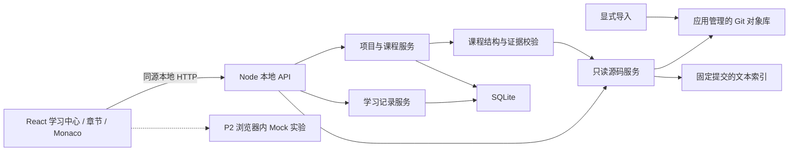

# 整体架构

交付形态为单用户本地 Web 应用。React + TypeScript 客户端负责学习体验；一个绑定回环地址的 Node.js + TypeScript 进程拥有数据目录、Git 适配器、课程验证和 SQLite 写权限。P1 用同源 HTTP、普通请求和单机事务即可覆盖完整学习路径。

| 模块 | 职责和依赖 |
| --- | --- |
| 客户端 | 学习中心、课程与阅读器共享 release 和证据 ID；Monaco 只显示服务端返回的文本，Mermaid 展示经过审核、按严格模式渲染的流程图。P1 可按课程 execution 生成顺序图 |
| 项目与仓库 | 从配置提供来源目录，区分登记和导入；GitHub 获取、本地导入均写入应用管理的对象库。按仓库和 SHA 保留引用；上游地址不构成课程信任证明 |
| 源码读取与索引 | Git tree 枚举，按 blob 读固定文本。P1 用 Git 定位文件与已审证据；P2 可将已验证的普通文本导出为只读快照，按仓库、SHA、索引版本缓存 ripgrep 结果。文本候选展示为候选，确认语言级精度需求后再评估 Tree-sitter |
| 课程与验证 | JSON Schema 结构检查 → 引用与前置图 → Git 对象及摘要 → SQLite 发布事务；返回章节及证据索引。客户端不能自行拼接磁盘路径 |
| 学习记录 | 管理状态、疑问、笔记、作答和复习查询；从课程读取答案；写操作绑定版次。单选由后端判定，追踪题记录自评来源（可由题型确定） |
| P2 导师与实验 | 本地导师从审核过的课程断言和证据回答；固定脚本 Mock LLM / Tool 产生事件、状态前后值，步进和自动播放消费同一个事件序列。模拟层只接触教学数据 |

## 三条关键数据流

1. **导入**。用户选项目和来源，后端验证来源及完整提交，获取所需 Git 对象到暂存区，核实 repo 身份及可读性，建立应用自己的持久 Git 引用，再登记 revision。引用先于数据库可见，失败留下的无主暂存可在重启后清理。重复导入复用同仓库同 SHA，不改用户工作树。
2. **学习与双向定位**。章节请求给出 release、证据 ID → 服务端取其仓库、提交、路径及行范围 → 按提交树读取并核对 blob → 返回同一坐标系的文本和标记。阅读器反向查同版同路径与选区相交的证据，经 lesson_evidence 返回章节及阅读位置。
3. **作答与恢复**。前端携带版次、章节、题号和请求 ID → 记录服务核对版本及题型、判定、追加 attempt → 返回解析及证据链接。重开章节以本地记录重建界面。阅读失败、发布失败和学习记录写入失败分别反馈，可独立重试。

## P1 接口契约草案

路径均在本地同源 `/api` 下。外部深链使用项目/课程/版次可移植键解析为本机 release ID。

| 请求 | 输入 → 输出 |
| --- | --- |
| GET /projects | 配置与本地课程 → 项目列表、开放状态、最新已发布版次和进度 |
| POST /imports | 仓库 ID、来源类型、规范 URL 或经本机选择的目录、完整提交 → 导入作业 ID；GET /imports/:id 返回进度或可重试原因 |
| POST /releases | 已登记来源的课程包 → 经校验的不可变版次；同内容重放返回既有 ID |
| GET /releases/:id/lessons/:lesson | 已发布版次 → 十二项课程内容、题目、证据入口、进度；作答解析在提交后展示 |
| GET /releases/:id/tree、/releases/:id/file | 受限的仓库相对路径 → 目录项或文本、blob ID；分页目录，大文件返回元数据 |
| GET /releases/:id/evidence/:key、/releases/:id/backlinks | 证据 ID 或路径和行范围 → 可复核定位或相关章节 |
| PUT /releases/:id/lessons/:lesson/progress | 明确的目标状态 → 已保存状态 |
| POST /entries、PATCH /entries/:id | 所属版次/章节、可选证据、正文或疑问状态 → 已保存条目 |
| POST /attempts、GET /review | 作答及请求 ID → 判定和解析；项目/版次筛选 → 学习记录与待复习错题 |

参数格式错误返回 400，未知资源 404，版次或重复请求冲突 409，内容或证据校验失败 422。错误带稳定原因码、涉及字段及可执行的恢复动作。目录选择只允许用户明确提供的本机来源，导入后的读取接口只接受逻辑 ID 和仓库内路径。

## 本地部署与扩展

前端静态资源、编辑器及图表依赖随应用本地分发。数据目录包含 SQLite 库、按 repository ID 隔离的 Git 对象库、按 SHA 命名的只读索引缓存，以及按内容哈希存放的官方资料快照。备份覆盖数据库、被引用的 Git 对象和资料快照；文本索引可重建。P1 验收从空目录启动、重启和断网三种情况。

后续项目复用仓库、证据及学习记录接口，各自编写课程。跨项目比较显式引用每一格的 release 和证据。网络模型、桌面打包、远程数据库、多用户同步与真实代码运行需要另行确定使用场景。
