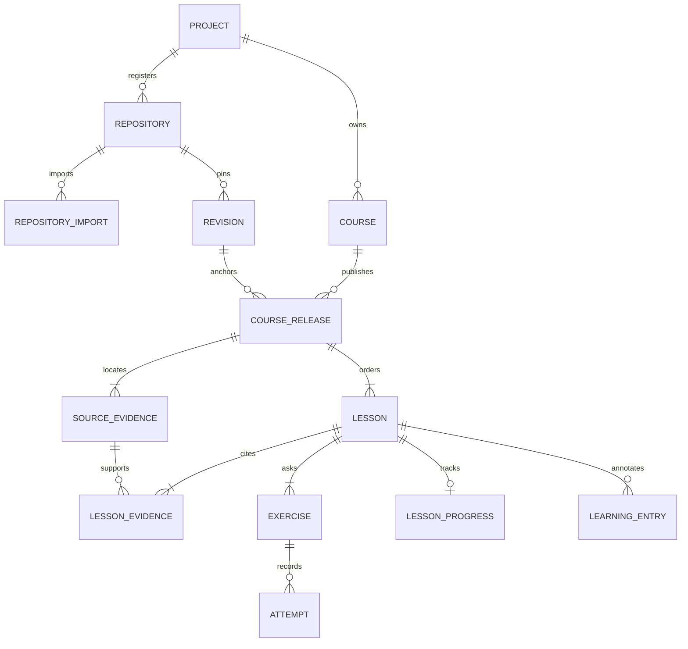

# 数据库设计

设计基线见 [SQLite DDL](schema/academy.sql)。数据库服务于一个本地学习者；身份来自本机数据目录。主数据分三处：Git 对象提供源码，课程原文提供教学内容，SQLite 保存课程原文、可重建索引和用户学习记录。

| 实体 | 身份和持久化规则 |
| --- | --- |
| project / repository / repository_import | 项目有稳定 ID，可登记公开仓库、SDK 仓库或本地仓库。同一仓库的 GitHub 地址、本机目录是不同导入入口；规范化后重复导入可复用。无远程的本机 Git 仓库分配独立仓库 ID；不能凭目录名推定等于 Pi |
| revision | 主键为仓库 ID 与完整提交 SHA。确认本地有可读取的 commit 对象并持有保留引用后才能写入；配置中的远端基线本身不代表已下载 |
| course / course_release | 课程 ID 在项目内稳定；版次从 1 递增。每版固定一个主仓库与提交，复合外键防止串项目或引用未知版本。数据库整数 release ID 用于本地路由，可移植标识是项目、课程、版次 |
| lesson / source_evidence / lesson_evidence | 章节 ID、证据 ID 以版次为命名空间。证据继承该版的仓库和 SHA；同版各章可以引用同一证据。反链包括正文、习题、总结等所有引用。以路径和行区间相交查询打开代码的所有相关章节 |
| exercise / attempt | 题目在版次和章节内唯一。每次提交保存答案、判定与 UTC 时间。单选保存选项 ID，追踪题保存文字，由学习者对照评分点自评。request_id 由客户端为一次作答生成，重试复用；重复键且载荷不同需返回冲突 |
| lesson_progress / learning_entry | 初始无进度行等同 unstarted，首次阅读设 reading，学习者可完成或重新打开。条目分笔记和疑问，疑问可标记已解决，可附加本章证据。章节、版本是学习记录身份的一部分 |

## 发布和派生数据

1. 先校验课程 JSON、所有引用及 Git 对象，再开写事务。以输入原文为事实来源，写入 course_release.document，按数组次序产生 lesson、exercise、source_evidence、lesson_evidence 索引。课程字段与索引统一由发布服务写入。数据库使用 STRICT 表，触发器拒绝原地更新已发布的课程原文和版本标识。
2. 同一项目/课程/版次重复导入时，比较解析后的完整 JSON（对象键无序、数组有序）。相同返回已有版次；不同返回冲突。版次分配和唯一性检查在同一写事务内完成，失败全部回滚。SQLite 每个连接显式启用外键；写入按序进行，忙锁超时可重试。
3. 升级课程新增 release。笔记、进度与作答仍指向旧版。新版本从零计数；历史页面允许选择旧版。删除来源缓存前识别所有引用；仍有已发布课程的对象保留，损坏时按原 SHA 恢复。
4. 完成率分子为本版 completed 章节数，分母为本版总章节数；无已发布章节显示“待开放”。错题历史取所有 incorrect 尝试；待复习错题取每道题最大 attempt.id 的结果仍为 incorrect 的记录。最近作答正确会退出队列，首次错误仍计入历史。
5. 前置知识图、教学断言和资料索引读取发布原文；裁剪出的 SQL 索引可从原文重建。P2 的模拟状态驻留内存，重置恢复初始种子；学习统计从进度与作答派生。P6 对比项引用多个独立版次的证据，不改动已有课程的版本边界。

## 存储演进与恢复

DDL 描述空库的目标状态。P1 首次启动把该基线纳入顺序迁移；之后用 PRAGMA user_version 选择升级步骤。升级前备份 SQLite 和与课程对应的 Git 对象及资料快照。迁移事务失败回滚并保留旧库。恢复演练要同时检查外键、旧版深链、证据摘要及学习记录数。

P1 应用版本为 2。首次启动先应用 v1 DDL，随后增加 `revision_store`，把（仓库、提交）关联到受管对象库的目录标识。对象核验完成后才在事务内切换这一关联；重新导入可以修复对象库并保留课程 ID。升级已有 v1 数据库前自动生成 SQLite 备份，遇到更新版本的数据库时停止启动并提示升级应用。[迁移入口](../server/base.ts)

P2 保持数据库 `user_version=2`。教材 `pi-foundations` v2 新增 release，与课程 v1 共用已固定源码但各自保存进度、条目和作答。通过内置教材更新接口即可离线新增 v2，旧记录与深链不变。

P2 统计按筛选后的每版每章每题计数。首次/最近分别取最小/最大 attempt.id；已答题数为至少有一次作答的题数。首次正确数、最近正确数的分母均为已答题数，未作答显示“未作答”，不产生除零百分比。待复习为最近 incorrect；“首次错 → 最近对”只统计首次 incorrect 且最近 correct。累计作答含所有有效 attempt，重试同一 request_id 不新增次数；追踪题按课程类型标记自评。所有统计从原记录派生，没有计数器回填或迁移。
